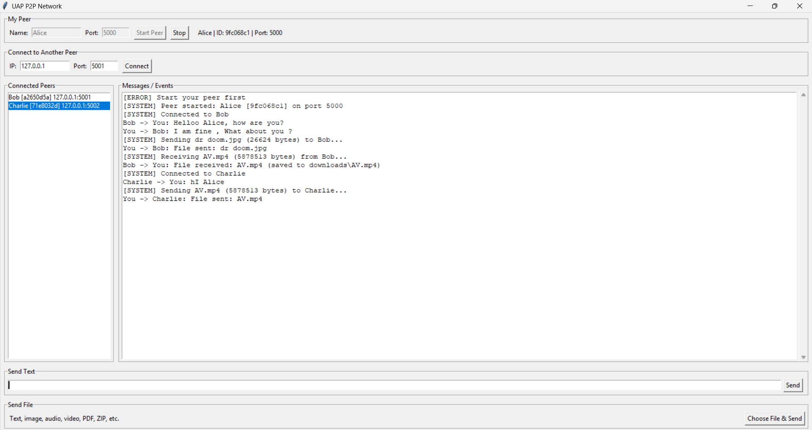
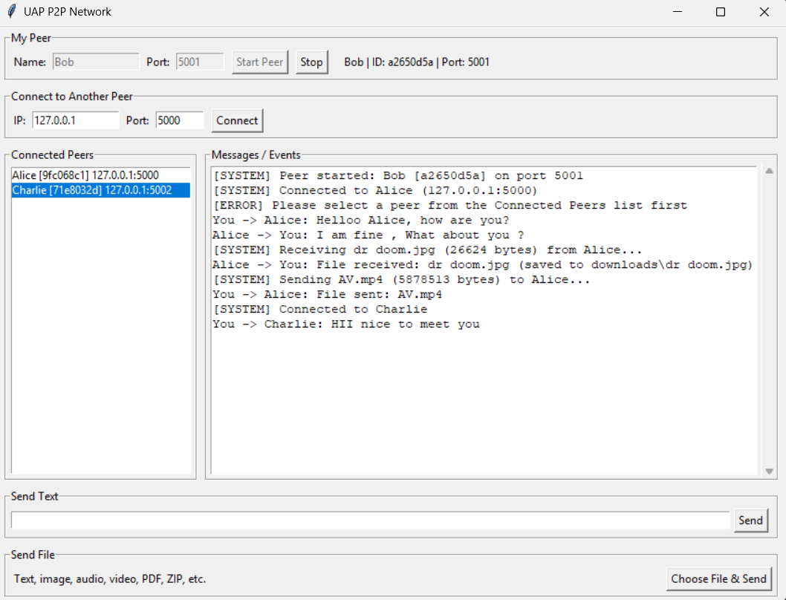
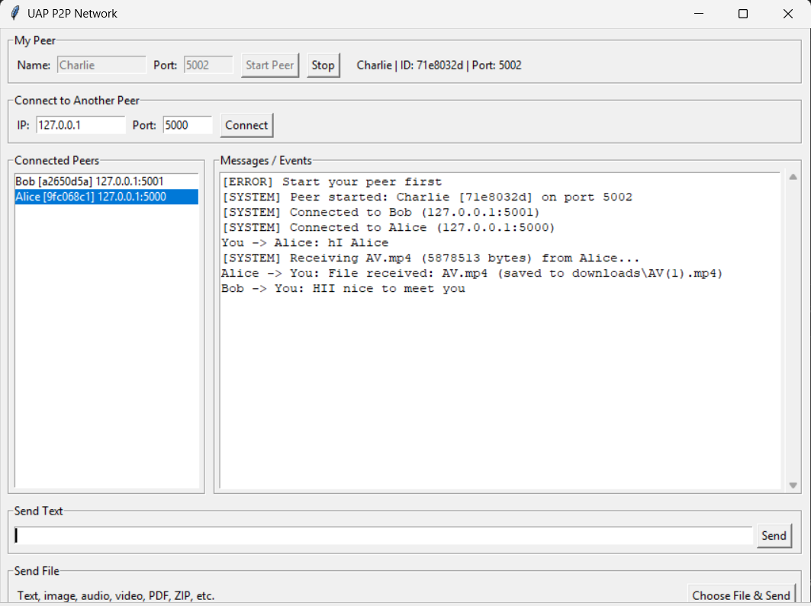

# Peer-to-Peer Network: Communication and File Sharing

## 1. Project Description

This project is a lightweight Peer-to-Peer (P2P) communication and file-sharing application developed in Python for the CSE 433 Blockchain & Distributed Security Lab assignment at the University of Asia Pacific.

Each running application represents one peer and works as both a TCP server and a TCP client. Peers connect directly to each other using an IP address and port number. There is no central server.

The application supports:

- Direct peer-to-peer TCP connections
- Peer identification using a unique peer ID, peer name, and port
- HELLO / HELLO_ACK handshake
- Text messaging between connected peers
- Binary file transfer in 64 KB chunks
- Multiple connected peers at the same time
- Received-file storage in a `downloads/` folder
- File transfer for text files, images, audio, video, PDF, ZIP, and other ordinary files

### Project Architecture

```text
User Interface (main.py)
      |
      v
P2P Node (p2p_node.py)
      |
      v
Protocol (protocol.py)
      |
      v
  TCP Socket
      |
      v
 Other Peer
```

Each peer contains both:

```text
TCP Server + TCP Client
```

---

## 2. Requirements

- Python 3.9 or later
- VS Code, PyCharm, or another Python editor
- Built-in Python `socket` library
- Built-in Python `threading` library
- Built-in Python `json` and `struct` libraries
- Tkinter for the graphical interface

---

## 3. Installation / Setup Instructions

### Step 1: Install Python

Install Python 3.9 or a newer version.

Check the installation:

```bash
python --version
```

### Step 2: Organize the Files

Place the project files in one folder like this:

```text
P2P_Network/
│
├── downloads/
│   ├── AV.mp4
│   └── dr doom.jpg
├── main.py
├── p2p_node.py
├── peer1.png
├── peer2.png
├── peer3.png
├── protocol.py
├── README.md
└── requirements.txt
```

The `downloads/` folder stores files received from other peers. `AV.mp4` and `dr doom.jpg` are example files received during testing. If the folder does not exist, the program creates it automatically.

### Step 3: Install Dependencies

No external packages are required. Only Python's built-in libraries are used.

### Step 4: Check Tkinter

Run:

```bash
python -m tkinter
```

If a small Tkinter window opens, the GUI environment is ready.

---

## 4. How to Run the Application

Open a terminal inside the project folder and run:

```bash
python main.py
```

The GUI allows the user to enter:

- Peer Name
- Listening Port
- Remote IP address
- Remote Port

After clicking **Start Peer**, the log shows:

```text
[SYSTEM] Peer started: Alice [9fc068c1] on port 5000
```

### Example

Peer A:

```text
Name: Alice
Port: 5000
```

Peer B:

```text
Name: Bob
Port: 5001
```

For testing on the same computer, Bob connects to:

```text
IP: 127.0.0.1
Port: 5000
```

---

## 5. How to Connect Two Peers

### Peer A

1. Run `python main.py`.
2. Enter a peer name, for example `Alice`.
3. Enter a listening port, for example `5000`.
4. Click **Start Peer**.

### Peer B

1. Run `python main.py` again in a second terminal.
2. Enter a peer name, for example `Bob`.
3. Enter a different listening port, for example `5001`.
4. Click **Start Peer**.
5. Enter Peer A's IP address.
6. Enter Peer A's port.
7. Click **Connect**.

For local testing:

```text
IP:   127.0.0.1
Port: 5000
```

After connecting, the peers perform a HELLO / HELLO_ACK handshake, and each peer appears in the other's **Connected Peers** list.

### Multiple Peers

A third peer can be started the same way:

```text
Name: Charlie
Port: 5002
```

Charlie can connect to Alice (port 5000), Bob (port 5001), or both.

### LAN Testing

When using two different computers on the same Wi-Fi or LAN, use the real local IP address of the computer running the target peer. On Windows, find it with:

```bash
ipconfig
```

Example:

```text
Computer A:
IP: 192.168.1.10
Port: 5000

Computer B:
IP: 192.168.1.11
Port: 5001
```

Computer B connects to:

```text
192.168.1.10:5000
```


---

## 6. How to Transfer Files

### Send a Text Message

1. Select a connected peer from the **Connected Peers** list.
2. Type a message in the **Send Text** box.
3. Click **Send**.

Example:

```text
Hello Alice!
```

### Send a File

1. Connect to the target peer.
2. Select the target peer from the **Connected Peers** list.
3. Click **Choose File & Send**.
4. Select the file and click **Open**.

The system supports ordinary binary files, including:

```text
.txt
.jpg / .jpeg / .png
.mp3 / .wav
.mp4 / .avi / .mkv
.pdf
.zip
.docx
```

The application does not need a separate transfer method for each file type. All files are treated as binary data.

### File Transfer Process

The sender first sends the file metadata:

```json
{
    "type": "file",
    "sender_id": "9fc068c1",
    "sender_name": "Alice",
    "filename": "photo.jpg",
    "filesize": 2456789
}
```

The sender then sends the raw file bytes in 64 KB chunks.

The receiver reads exactly `filesize` bytes and saves the file in:

```text
downloads/
```

For example:

```text
downloads/photo.jpg
```

If a file with the same name already exists, the new file is saved as `photo(1).jpg` instead of overwriting it.

---

## 7. Example Screenshots

Three peers running on one computer and all connected to each other.

### Screenshot 1 — Peer 1 (Alice, port 5000)

_Alice started on port 5000, connected to Bob and Charlie, exchanging messages, sending an image and a video, and receiving a video._



### Screenshot 2 — Peer 2 (Bob, port 5001)

_Bob connected to Alice and Charlie, sending and receiving text messages, receiving an image and sending a video._



### Screenshot 3 — Peer 3 (Charlie, port 5002)

_Charlie connected to both Alice and Bob, communicating with both peers and receiving a video file._



---

## 8. Run Command

The complete project runs with:

```bash
python main.py
```

